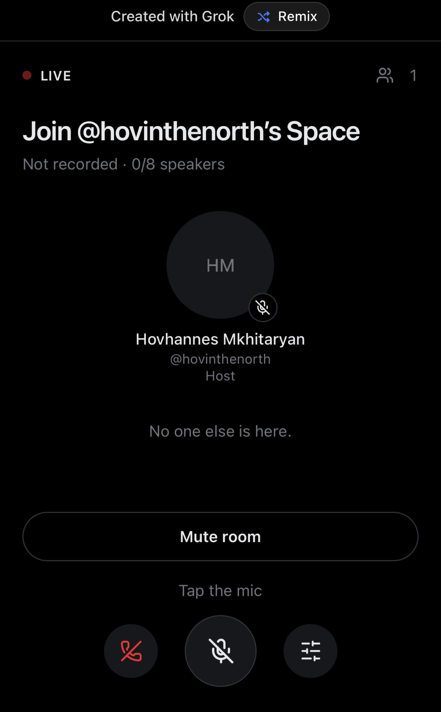

# Join @hovinthenorth’s Space

Open audio room. Not recorded.

**The web app is the demo:** [async-spaces.grok.me](https://async-spaces.grok.me)

One room, open all the time. You can hear it without an account. Sign in with X to request a mic.



Source: [github.com/hovtgc/open-space](https://github.com/hovtgc/open-space)

## Room

- 50 listeners. New people wait until someone leaves.
- 8 speaker seats. The host admits someone for 24 hours, then they request again.
- Host is [@hovinthenorth](https://x.com/hovinthenorth).
- Audio goes browser to browser. Nothing is recorded.

## Run

```bash
npm install
npm run dev
```

The app listens on port 8080. Deployed, it expects Postgres (`DATABASE_URL`) and X sign-in through Better Auth. Without `DATABASE_URL`, a local run uses embedded Postgres.

## License

[MIT](LICENSE)
